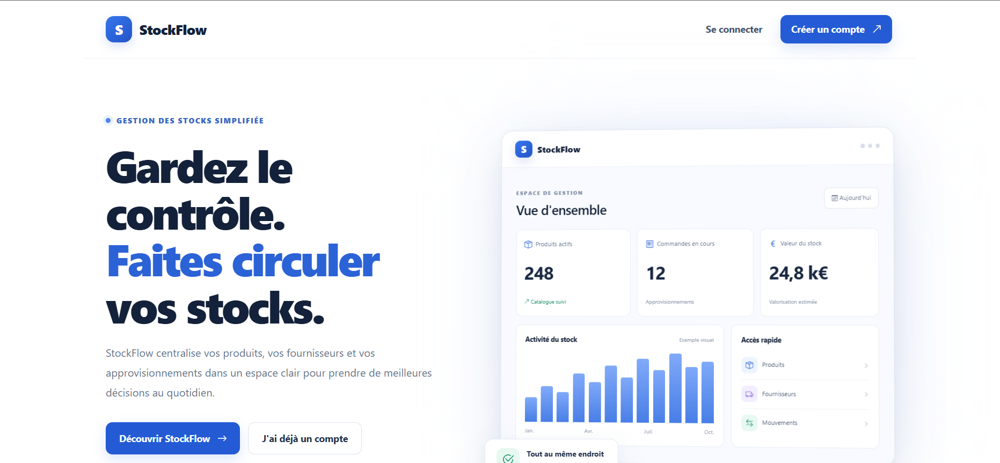
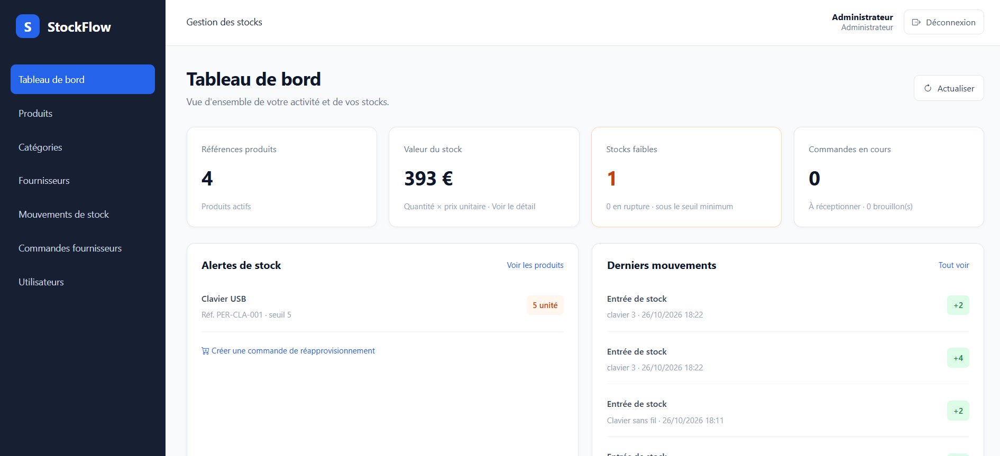
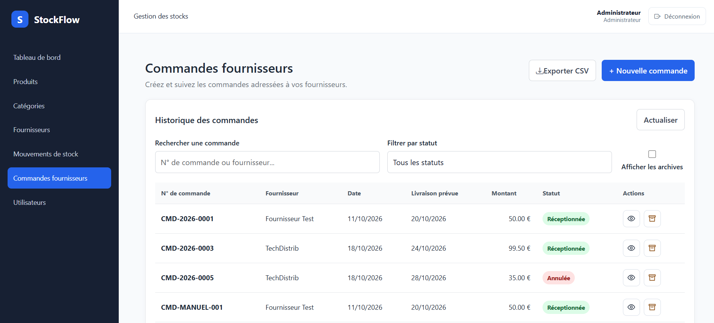

# StockFlow ERP

**Application web de gestion des stocks destinée aux petites et moyennes entreprises (PME).**

StockFlow ERP est une application full-stack conçue pour centraliser et simplifier la gestion des stocks, des produits, des fournisseurs, des mouvements de stock et des commandes d'achat.

Ce projet vise à proposer une solution de gestion métier avec une interface moderne, une API REST et une architecture séparant le frontend du backend.

## Démonstration

- **Application en ligne :** https://stockflow-three-steel.vercel.app/
Si le backend ne fonctionne pas, relancer le backend avec https://stockflow-g7pe.onrender.com/, puis retourner à l'application.







## Fonctionnalités

- **Tableau de bord** — Vue d'ensemble des principales informations liées à la gestion des stocks.
- **Gestion des produits** — Consultation et gestion des références produits et de leurs informations.
- **Gestion des catégories** — Organisation des produits par catégories.
- **Gestion des fournisseurs** — Centralisation des informations fournisseurs.
- **Mouvements de stock** — Suivi des entrées et des sorties de stock.
- **Commandes d'achat** — Création et gestion des commandes d'achat, consultation de leurs détails et archivage.
- **Gestion des utilisateurs** — Gestion des comptes utilisateurs de l'application.
- **Authentification et autorisations** — Sécurisation de l'accès à l'application grâce aux JWT et à une gestion des rôles.
- **Pages publiques** — Page d'accueil, connexion et inscription.

Le projet est développé progressivement, avec une attention particulière portée à la cohérence des données, à la maintenabilité du code et à l'expérience utilisateur.

## Technologies utilisées

### Frontend
- Angular
- TypeScript
- HTML
- CSS

### Backend
- Java 25
- Spring Boot 4
- Spring Security
- Spring Data JPA
- Hibernate
- API REST
- JSON Web Token (JWT)

### Base de données et outils
- PostgreSQL
- Flyway — gestion des migrations de base de données
- Maven
- Git

## Architecture

StockFlow ERP repose sur une architecture frontend/backend :

- **Frontend :** application Angular chargée de l'interface utilisateur et des échanges avec l'API.
- **Backend :** API REST développée avec Spring Boot, responsable de la logique métier, de la sécurité et de l'accès aux données.
- **Base de données :** PostgreSQL pour le stockage persistant des informations.
- **Migrations :** Flyway pour versionner et gérer l'évolution du schéma de la base de données.

## Installation et lancement

### Prérequis

Les outils suivants doivent être installés :

- Java 25
- Node.js et npm
- PostgreSQL
- Git

### 1. Cloner le dépôt

```bash
git clone git@github.com:sd-projet/stockflow.git
cd stockflow
```

### 2. Configurer la base de données

Créer une base de données PostgreSQL nommée `stockflow_db`.

Configurer les paramètres de connexion à la base de données dans la configuration du backend, en utilisant les identifiants de votre environnement local.

Les migrations Flyway permettent de gérer l'évolution du schéma de la base de données. Vérifier que PostgreSQL est accessible avant de démarrer le backend.

### 3. Configurer la clé JWT

Définir la variable d'environnement `STOCKFLOW_JWT_SECRET` avant de démarrer le backend.

Utiliser une clé secrète suffisamment robuste et ne jamais publier de secrets, de mots de passe ou d'identifiants sensibles dans le dépôt Git.

### 4. Démarrer le backend

Depuis le dossier du backend, exécuter :

```powershell
.\mvnw.cmd spring-boot:run
```

L'API est accessible localement à l'adresse suivante :

`http://localhost:8080`

### 5. Démarrer le frontend

Depuis le dossier de l'application Angular, installer les dépendances :

```bash
npm install
```

Lancer le serveur de développement :

```bash
npx ng serve
```

Le frontend est accessible localement à l'adresse suivante :

`http://localhost:4200`

Vérifier que la configuration du frontend pointe vers l'URL du backend démarré précédemment.

## Tests

Pour exécuter les tests du backend, depuis le dossier correspondant :

```powershell
.\mvnw.cmd test
```

La couverture de tests automatisés pourra être étendue progressivement, notamment pour le frontend et les principaux parcours utilisateur.

## Sécurité

L'application intègre plusieurs mécanismes de sécurité :

- Authentification par JWT.
- Contrôle des accès selon les rôles des utilisateurs.
- Hachage des mots de passe.
- Protection des routes et des endpoints nécessitant une authentification.
- Validation des données et gestion des erreurs côté serveur.

Les informations sensibles doivent être configurées à l'aide de variables d'environnement et ne doivent pas être versionnées dans le dépôt.

## État du projet

StockFlow ERP est un projet de portfolio en cours de développement.

La version actuelle se concentre sur les principales fonctionnalités de gestion des stocks et sur la mise en place d'une architecture évolutive et maintenable.

Les prochaines améliorations porteront notamment sur le renforcement de la gestion des sessions, l'élargissement des tests automatisés et le déploiement de l'application.


## À propos

StockFlow ERP est développé dans le cadre de mon portfolio afin de mettre en pratique et de démontrer mes compétences en développement frontend et backend, en conception d'API REST, en gestion de bases de données et en sécurisation d'applications web.
